<p align="center">
  <picture>
    <source media="(max-width: 640px)" srcset="assets/banner-m.svg">
    
  </picture>
</p>

Desarrollador full stack, IoT y DevSecOps en Madrid. Me gusta entender cómo funcionan las cosas y construirlas de verdad: de la interfaz al despliegue, y después mantenerlas en producción. Uso la IA como herramienta de trabajo, no como sustituto del criterio técnico.

> Cuanto más aprendo, más me equivoco; y cada error me obliga a entender mejor el problema.

<sub>EN · Full-stack, IoT and DevSecOps developer in Madrid. I build complete products, from UI to production.</sub>

### Proyectos

**[ACTUA 2.0](https://actua2.dbblab.es/)** · DBBasico — análisis de sonometría y generación automática de actas técnicas y policiales. De principio a fin: diseño, aplicación, lógica, despliegue y mantenimiento. En producción.<br>
`Next.js` `TypeScript` `Node.js` `MongoDB`

**[IRMA](https://about.dbblab.es/irma)** · DBBasico — monitorización IoT de vibraciones industriales en tiempo real: app móvil, dashboard, históricos y alertas. En producción.<br>
`React Native` `Next.js` `Node.js` `MongoDB` `MQTT`

**Finzen** — SaaS que consolida cuentas bancarias, inversión y cripto en una sola vista. En desarrollo.<br>
`Next.js` `TypeScript` `Postgres` `Docker`

**[cv.sergioromerohd.com](https://cv.sergioromerohd.com)** — mi portfolio, con el código en abierto: [sergioromerohd/portfolio](https://github.com/sergioromerohd/portfolio).<br>
`Next.js` `Tailwind` `Docker` `GitHub Actions`

### Stack

<picture>
  <source media="(max-width: 640px)" srcset="assets/stack-m.svg">
  
</picture>

### Actividad

<picture>
  <source media="(max-width: 640px)" srcset="assets/stats-m.svg">
  
</picture>

### Trayectoria

```text
2026 – hoy   CSA         equipo DevSecOps
2024 – 2026  Orwee       frontend y UI
2024 – 2026  DBBasico    full stack
2023         BBVA Next   prácticas · Go
```

### Contacto

[cv.sergioromerohd.com](https://cv.sergioromerohd.com) · [LinkedIn](https://www.linkedin.com/in/sergioromerohd/) · Madrid, España

<!-- ¿Curioseando el código? Banner, stack y actividad salen de scripts/assets.py; la actividad se regenera cada día con GitHub Actions. -->
